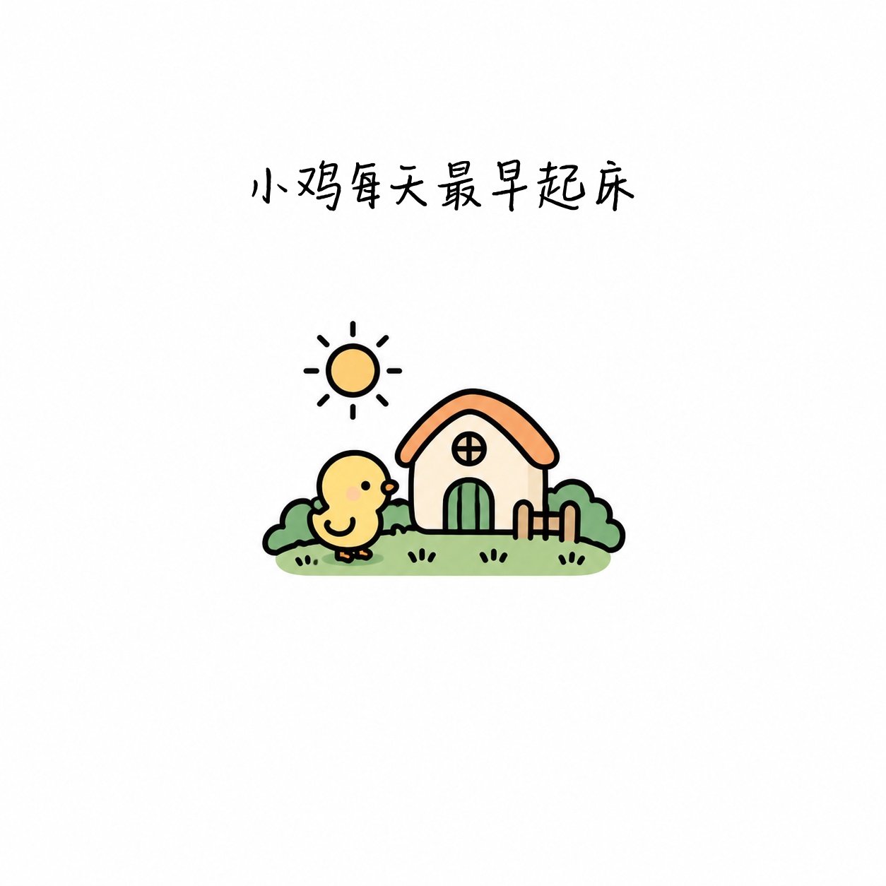
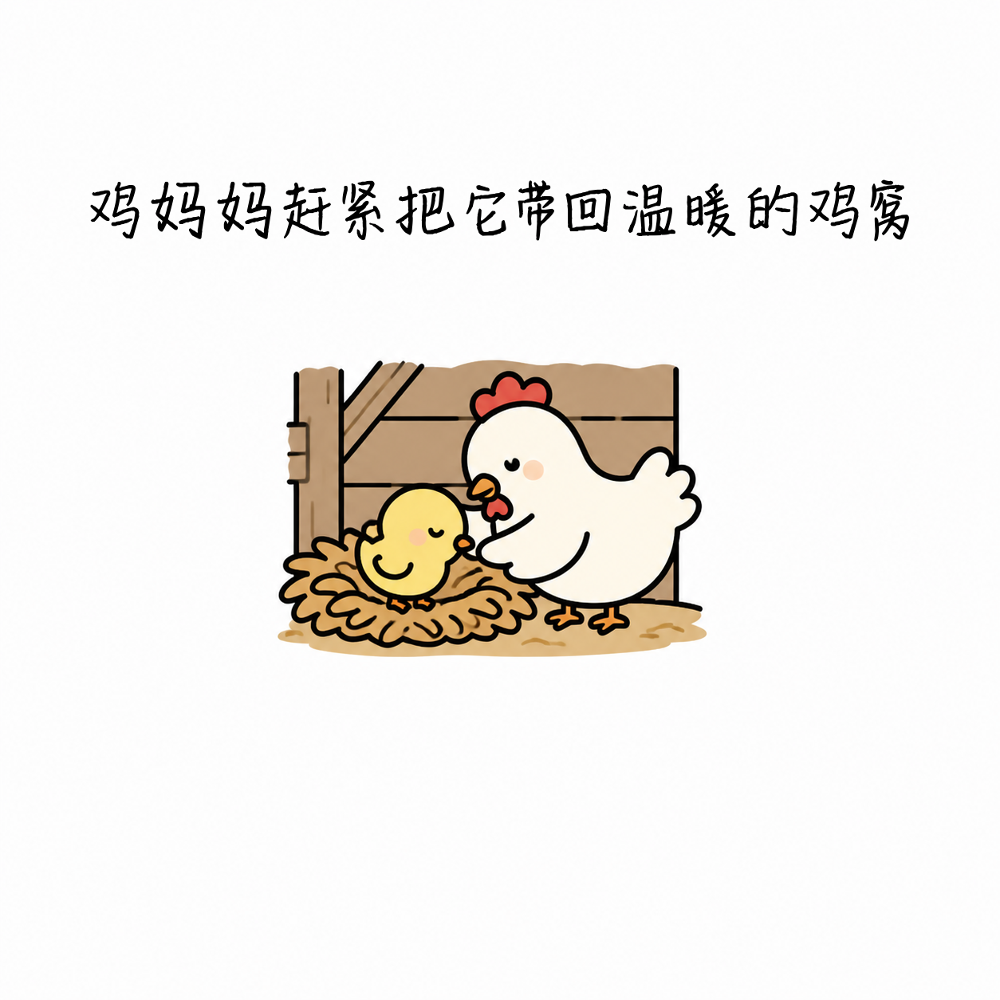
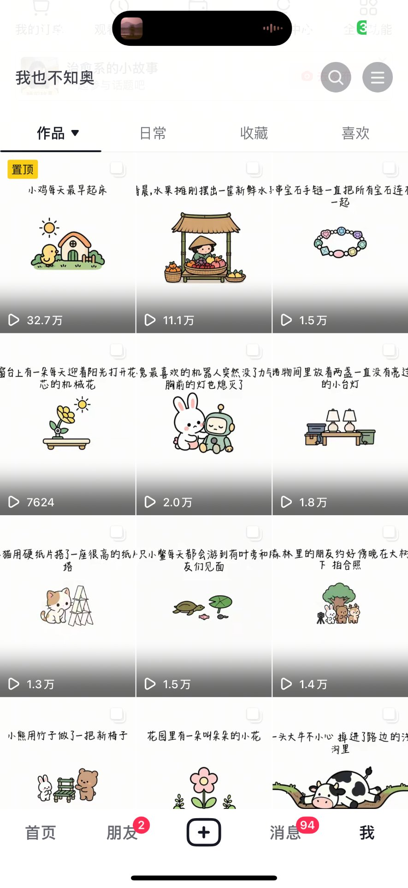
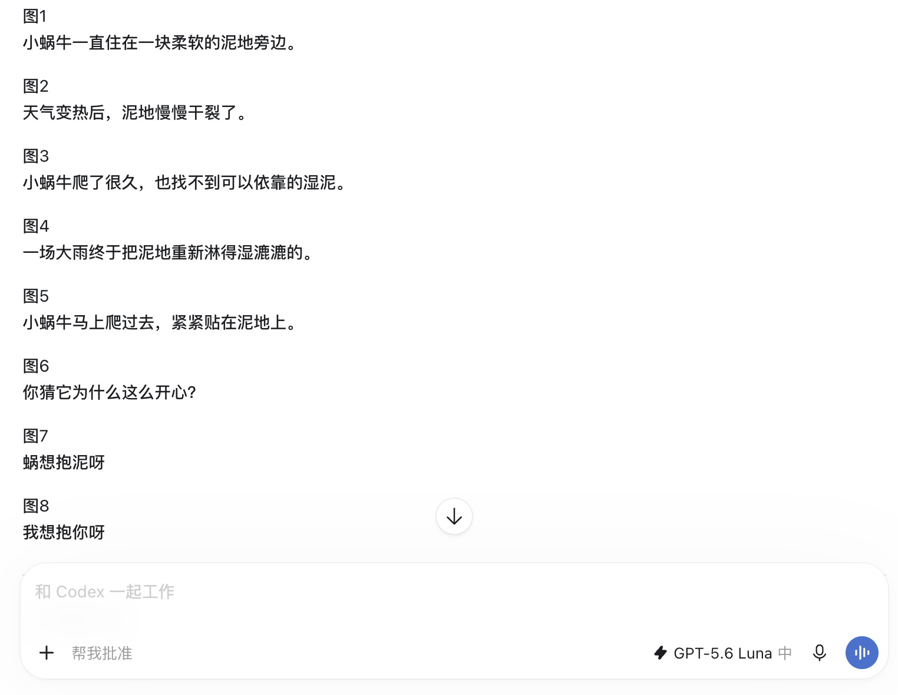
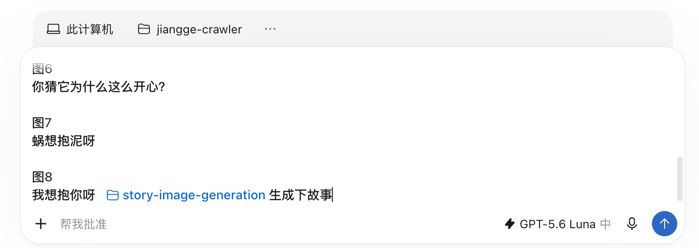
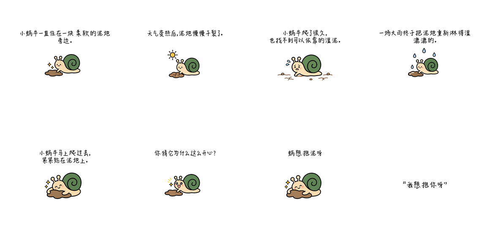

# jiangge-crawler

> 把一句关心，画成一个会心一笑的八格故事。

**中文谐音梗故事创作工具集**：从「鸡得休息呀」到「记得休息呀」，一条流水线完成谐音创意、分页文案、无文字插画、手写旁白叠加与发布素材整理。仓库不收录采集脚本、账号 Cookie 或下载素材，只保留可长期复用的创作与图片后期工程。

## 作品预览：《记得休息》

一只每天最早起床的小鸡，从早到晚找虫子、搬稻草，忙到走路摇摇晃晃。鸡妈妈把它带回温暖的鸡窝，它睡醒后又有了精神。翻到最后一页才发现，这其实是一句带着谐音的关心：

> 关心：**记得休息** · 谐音：**鸡得休息**

下面是这套流程产出的 8 格成品，点击任意一页可查看原图。素材位于 [`story/stories/鸡得休息呀/`](story/stories/鸡得休息呀/)：

<table>
  <tr>
    <td align="center"><a href="story/stories/鸡得休息呀/final/01.png"></a></td>
    <td align="center"><a href="story/stories/鸡得休息呀/final/02.png"></a></td>
    <td align="center"><a href="story/stories/鸡得休息呀/final/03.png"></a></td>
    <td align="center"><a href="story/stories/鸡得休息呀/final/04.png"></a></td>
  </tr>
  <tr>
    <td align="center"><a href="story/stories/鸡得休息呀/final/05.png"></a></td>
    <td align="center"><a href="story/stories/鸡得休息呀/final/06.png"></a></td>
    <td align="center"><a href="story/stories/鸡得休息呀/final/07.png"></a></td>
    <td align="center"><a href="story/stories/鸡得休息呀/final/08.png"></a></td>
  </tr>
</table>

完整分页文案见 [story/故事.md](story/故事.md#记得休息)，逐页提示词见 [story.txt](story/stories/鸡得休息呀/story.txt)。

## 账号数据

同一套内容在平台上积累的历史播放量：

<p align="center">
  
</p>

首屏《小鸡每天最早起床》达到 **32.7 万**播放，其余作品也稳定在万级区间。

## 它能做什么

- **谐音创意与分页文案**：围绕关心、情话、调侃等主题设计双关，再拆成 8 页节奏，统一维护在 `story/故事.md`。
- **无文字插画**：每页只生成画面，不生成文字，方便复用画风、替换文案或做多语言改写。
- **手写旁白叠加**：`overlay_text.py` 处理单页，`batch_overlay.py` 按 `story.txt` 批量叠字，末页支持特殊收尾样式。
- **发布素材整理**：`story/public_story/` 用于公开发布整理稿，`account_brand/` 存放账号品牌图，规则和经验沉淀在 `skills/`。

## 推荐工作流

1. 用 `skills/story-writing/` 创作或审核故事，确认谐音因果、页序和分页文案。


2. 将确认后的文案复制到 `story/stories/<故事名>/story.txt`，作为后续生图的唯一输入。



3. 用 `skills/story-image-generation/` 生成故事，保存到 `story/stories/<故事名>`。



4. 原图验收通过后，用 `story-publishing` 执行 `python3 batch_overlay.py <故事名>`，把旁白叠加到 `final/`，检查页数、尺寸和文字遮挡，再将最终成品组图用于发布或复盘。



## 项目结构

```text
jiangge-crawler/
├── story/                  # 故事文案、插画、成品与发布资料
│   ├── 故事.md             # 故事分类、索引和全部文案
│   ├── stories/            # 每个故事的 raw / final / story.txt
│   └── story_reference/    # 画风参考图，只用于风格约束
├── skills/                 # 故事创作、配图与发布流程
├── account_brand/          # 账号品牌图片
├── fonts/                  # 叠字字体
├── overlay_text.py         # 单页叠字
├── batch_overlay.py        # 批量叠字
└── test_batch_overlay.py   # 叠字与文案格式测试
```
